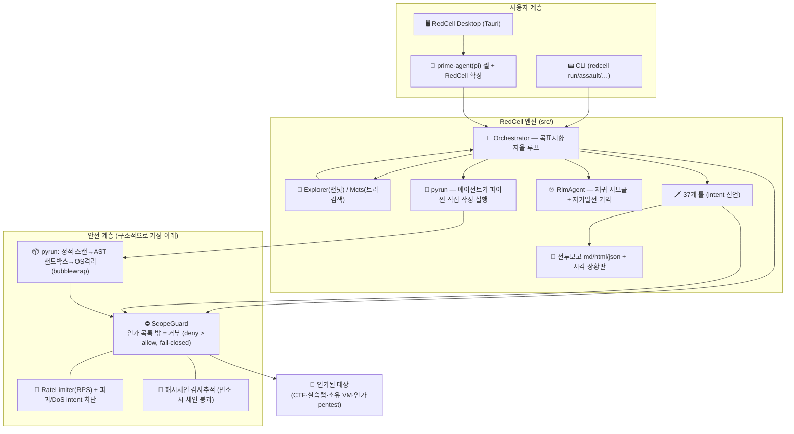
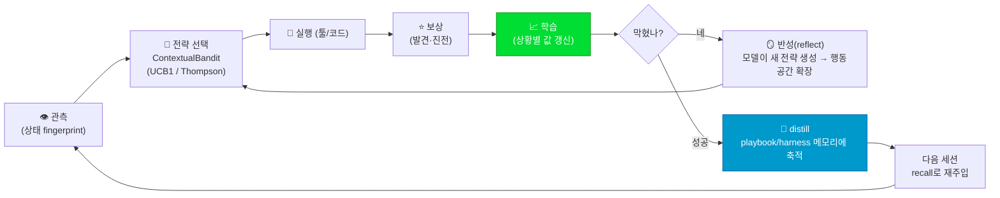
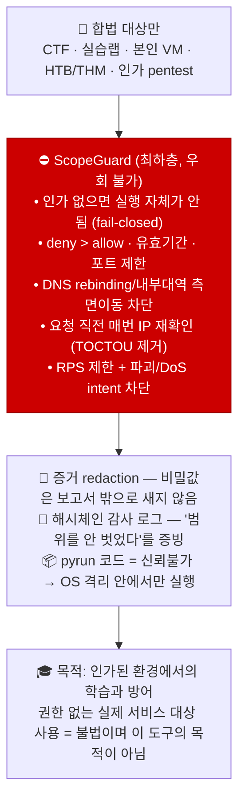

# absolute-agent(RedCell) — 프로젝트 소개 & 구조 총정리

> **한 줄 요약**
> **RedCell(레드셀)은 "자신의 서비스·랩만" 대상으로 합법적으로 학습하고 스스로 발전하는,
> 자기발전형(self-improving) 화이트해커 훈련 에이전트다.**
> 잘 뚫는 법을 실패와 성공의 결과에서 배우고, 성공한 전술을 축적해 **다음엔 더 빨리** 뚫도록 진화한다.
> 인가(authorization) 없이는 하나도 동작하지 않는다 — 안전이 최하층에 구조적으로 박혀 있다(safe-by-construction).

```
┌─────────────────────────────────────────────────────────────────────────┐
│  🛡️  RedCell  —  URL 하나 넣으면 정찰→공격→증거→전투보고까지 자동      │
│  🧠  배우며 발전  —  밴딧·MCTS 탐색 엔진이 성공한 전략을 다음 세션에 재사용 │
│  📟  데스크톱 앱 —  일반인도 URL 넣고 대화로 지시하면 에이전트가 수행      │
│  ⛔  fail-closed —  인가 목록 밖 호스트는 어느 경로로도 절대 못 나감      │
└─────────────────────────────────────────────────────────────────────────┘
```

---

## 1. 이 프로젝트로 하려는 것 — 어떤 문제를 푸는가

| 💔 이런 문제가 있었다 | ✅ RedCell이 하는こと |
|---|---|
| 취약점 도구는 **정해진 체크리스트**로 한쪽만 두드린다 | 37개 다각 툴 + **발산형 플래너**가 안 써본 벡터부터 넓게 시도 |
| 도구는 **배우지 못해** 매번 처음부터 시작한다 | **자기발전 루프**(밴딧·MCTS·반성)로 성공 전술을 축적 → 반복할수록 빠짐 |
| "뚫릴 수 있다"는 **증거 없는 가능성** 수준에 그친다 | **검증 엔진**이 각 발견을 `✅ 실증 / ⚠️ 징후 / ❓ 미확인` 배지로 승격·강등 |
| 해킹 학습 허들이 너무 높다 | `redcell learn` **해킹 학습 투어** — 인가된 로컬 랩에서 안내받으며 직접 뚫어봄 |
| 비개발자·보안 신입은 결과를 **판단 못 한다** | 리포트 맨 위의 **문자만 쓴 시각 상황판**(신호등 판정 + 킬체인 그림 + 위험도 막대) |
| 일반인은 CLI를 못 쓴다 | **RedCell Desktop** — URL 넣고 대화로 지시하면 에이전트가 수행 |

---

## 2. 프로젝트 구조 (모노레포)

```
absolute-agent/
├── redcell/                    # 🔧 핵심 엔진 (TypeScript, Node ≥ 20)
│   ├── src/
│   │   ├── explore/            # 🧠 자기발전 심장 — 밴딧(UCB1/Thompson)·MCTS(UCT)·탐색 루프
│   │   │   ├── bandit.ts       #   상황별 "어떤 액션이 통했는가"를 학습
│   │   │   ├── explorer.ts     #   시도→보상→반성→백트래킹→distill 루프
│   │   │   ├── mcts.ts         #   상태 전이/막다른 길 환경의 최적 경로 트리검색
│   │   │   └── real-env.ts     #   실대상도 시뮬레이션과 동일하게 구동
│   │   ├── tools/              # 🗡️ 37개 다각 공격 표면 툴 (recon/enumerate/exploit)
│   │   │   (sqli·xss·ssrf·idor·ssti·cmdi·xxe·smuggle·cache 기만·JWT 위조 …)
│   │   ├── core/               # 🎯 Orchestrator(목표지향 자율 루프)·AutoPilot(모델 없음)
│   │   │   ·PayloadForge(동적 페이로드)·credential-harvest(발견 체이닝)
│   │   ├── assault/            # 💥 URL 하나 → 자동 공격 캠페인 파이프라인
│   │   │   (recon→열거→exploit→증거 redaction→분석→전투보고 md/html/json)
│   │   ├── harden/             # 🧱 오픈(출시) 전 강화·게이트: 설명서/pro파일→강화평가→PASS/FAIL
│   │   ├── osint/              # 🔍 웹 샅샅이 뒤지기: 시드 사이트 BFS 크롤+정보 추출
│   │   ├── learn/              # 🎓 해킹 학습 투어 (로컬 랩 6강의, 127.0.0.1 고정)
│   │   ├── py/                 # 🐍 에이전트가 스스로 파이썬 작성→실행 (absolute-agent 모드)
│   │   │   (로컬 HTTP 브로커 + 정적 스캔 + AST 샌드박스 + OS 격리 bubblewrap)
│   │   ├── rlm/                # ♾️ 재귀 언어 모델: 영구 Python REPL + 재귀 서브콜
│   │   ├── scope/              # ⛔ ScopeGuard — 인가 게이트 (fail-closed, 최하층)
│   │   ├── models/ providers/  # 🤖 다중 LLM 프로바이더 (Anthropic·OpenAI호환·로컬·custom)
│   │   ├── memory/             # 💾 SkillMemory — fingerprint 색인 playbook recall/distill
│   │   ├── net/ audit/ panel/  # 🌐 HTTP 클라이언트·RPS / 🔐 해시체인 감사추적 / 📊 실시간 패널
│   │   └── cli.ts              # 📟 CLI: run·pyrun·rlm·assault·harden·osint·learn·…
│   ├── bench/                  # 📏 벤치마크: 도구 정확도·블라인드 외부 검증·랩 해결률·RL곡선
│   ├── labs/                   # 🏫 14개 로컬 실습 랩 (취약 13 + clean 1)
│   ├── prime-agent/            # 🔌 prime-agent(pi) 확장 — 인가 게이트 + 커스텀 툴 통합
│   ├── skills/ knowledge/      # 📚 pentest-lab 스킬 + 학습된 전술 JSON
│   └── test/                   # ✅ 430+ 테스트
└── redcell-desktop/            # 🖥️ Tauri(Rust) 데스크톱 앱
    ├── ui/                     #   세션 탭·대화 패널·진단 모드·진단 이력 대시보드
    └── src-tauri/              #   pi CLI 래퍼 (모든 tool_call을 RedCell 인가 게이트로 검사)
```

---

## 3. 큰 그림 — 어떻게 동작하는가

### 3.1 계층 구조 (안전이 바닥에)



### 3.2 자기발전 루프 — "배워서 빨라지는" 핵심



**효과가 숫자로** (데모에서 실측):

```
[explore] 초반 10회 평균 스텝: 13.6  →  후반 10회 평균 스텝: 6.7 (최적 4)   ← 학습곡선
[mcts]    리프 243개(무작위 0.41%) 미로를 800 반복만에 정확한 경로로 해결
```

두 전략을 환경에 맞게 쓴다:

| 🎲 밴딧 (Explorer) | 🌲 MCTS |
|---|---|
| "지금 상태에서 제일 좋은 수?" | "여러 수 앞을 본 최적 경로?" |
| 에피소드 **간** 누적 학습 — 상태가 반복될 때 | 한 검색 **내** 트리 성장 — 전이·막다른 길이 있을 때 |
| 실대상 기본 (undo 불가) | 시뮬레이션 미로에서 계획 → 실대상에 적용 |

### 3.3 assault 파이프라인 — URL 하나면 끝까지

```mermaid
flowchart LR
    U["🔗 --url <대상>"] --> Z{"⛔ 인가됨?"}
    Z -- 안됨 --> X3[" 종료코드 3 (스캔 자체 시작 안 함)"]
    Z -- --authorize로 인가 --> R["📡 정찰 recon<br/>http_probe·header·crawl·waf_detect·jwt_audit"]
    R --> E["🗂️ 열거 enumerate<br/>dir_enum·secret_scan·cors·csrf·graphql…"]
    E --> X["🗡️ 공격 sweep<br/>sqli·xss·ssti·cmdi·ssrf·idor·smuggle·cache 기만·JWT 위조…"]
    X --> EV["🧾 증거 수집<br/>+ redaction (비밀값 마스킹)"]
    EV --> V["✅ 검증 엔진<br/>실증 / 징후 / 미확인 배지 부여"]
    V --> CH["🧵 공격 경로 체인 합성<br/>+ 피해 반경(blast radius) + 방어 권고"]
    CH --> REP["📄 report.md / .html / .json<br/>+ 초보자 시각 상황판(ASCII)"]
```

리포트 최상단 **시각 상황판**은 색·이미지 없이 문자만(`─▶█`)으로 그려 어떤 터미널에서나 동일하게 읽힌다:

```
 🔴 위험  —  지금 오픈하면 안 됨
 오픈(게이트 통과) 조건: 심각·높음 0건, 지금 2건 남음
 정찰 ──▶ 문 열기(취약) ──▶ 장악(가능)          [킬체인: 공격자 도달점]
 심각 ▇▇ (2)   높음 ▇ (1)   보통 ▇▇▇ (3)   낮음 ▇ (4)
 ┌───────────────────────────────────────────┐
 │ 🔴 SQL 인젝션 — 로그인 우회, 데이터 탈취 가능            │
 │    쉽게 말하면: 입력값이 코드에 그대로 들어가 버림          │
 │    왜 위험: 관리자 계정으로 들어갈 수 있음                │
 │    어떻게 막나: 파라미터화 쿼리 (🔴 24시간 내 · 개발팀)   │
 │    취약 엔드포인트: /login?user=…  근거: root 명령 실행 확인 │
 └───────────────────────────────────────────┘
```

### 3.4 pyrun(absolute-agent 모드) — 에이전트가 코드를 스스로 쓴다

고정 툴박스에서 고르는 대신, **모델이 파이썬 코드 작성 → 실행 → 관찰 → 다른 방법**을 반복:

```
 ┌─ LLM(코드는 LLM이 씀 → 신뢰불가로 취급) ─────────────────┐
 │  while not done:                                         │
 │      code = model.plan()          # rc.get/post/tcp·finding
 │      static_scan(code) ──위험패턴──▶ [안전차단]          │
 │      AST sandbox ──탈출시도────▶ [안전차단]               │
 │      OS 격리(bubblewrap) 없이 라이브 코드 = ⛔ 거 부      │
 │      broker → ScopeGuard.check(요청 직전 매번 재확인)     │
 │      observe → 다음 코드 (발산·백트래킹)                  │
 └───────────────────────────────────────────────────────────┘
 안전장치 5중: 로컬 1회용토큰 브로커 · 정적 스캔 · in-process AST 허용목록 ·
               bubblewrap OS 격리(fail-closed) · 연결 시점 IP 검증(DNS rebinding 차단)
```

### 3.5 데스크톱 앱 — 일반인을 위한 껍질

```
 redcell-desktop (Tauri)
   │  URL + 대화 지시 ("합격자 목록 파일로 뽑아줘")
   ▼
 pi CLI (-e redcell 확장, REDCELL_GATE=1)  ← 모든 tool_call을 인가 목록으로 검사
   ▼
 NDJSON 이벤트 스트림 → 좌측 pi 터미널 + 우측 대화 패널 (라이브)
```

- **서비스 진단 모드**: URL만 넣고 [진단] 원클릭 → 실측 정찰(비파괴 GET) 후
  "창의적 공격 루트 + 미리 막는 법" 리포트 (A~F 등급, 공격 흐름 화살표 다이어그램,
  단계 시뮬레이션 플레이어, [실증]/[징후]/[가정] 검증 배지)
- **진단 이력 대시보드**: 세션·대상별 보안 등급을 한 화면에
- **결과 탭**: 마크다운 렌더링 (의존성 0 자체 렌더러)

---

## 4. 사용 모드 cheat-sheet

| 모드 | 명령 | 무엇을 해주는가 |
|---|---|---|
| 📡 자율 스캔 | `redcell run --host … --goal …` | 목표지향 루프: 밴딧으로 다각 탐색(모델 또는 `--auto` 모델없음) |
| 💥 원샷 캠페인 | `redcell assault --url …` | 정찰→공격→증거→보고 자동 (결정적·재현 가능, `--no-ai` 오프라인 안전) |
| 🐍 에이전트 코딩 | `redcell pyrun --goal …` | 모델이 파이썬 작성→실행 반복 (안전 5중) |
| ♾️ 재귀 RLM | `redcell rlm --goal …` | 영구 Python REPL + 재귀 서브콜 + `rc.memo` 자기발전 기억 |
| 🧱 출시 게이트 | `redcell harden --description …` | 시스템 설명→강화 규칙 평가→`PASS/FAIL` (중요·높음 1건이면 오픈 불가) |
| 🔍 OSINT | `redcell osint --host … --goal …` | 사이트 샅샅이 뒤져 원하는 인텔 수집 (순수 GET, same-오리진만) |
| 🎓 학습 | `redcell learn start sql-injection` | 6개 강의 — 로컬 랩에서 안내받으며 직접 뚫어봄 (127.0.0.1 고정) |
| 🖥️ 데스크톱 | `cargo tauri dev` | URL+대화 지시, 진단 모드·대시보드 |

**릴리스 게이트 판정** (CI 종료코드로 자동 판별):

| 판정 | 의미 | 종료코드 |
|---|---|---|
| 🟢 `clean` | 측정 표면에서 취약점 0 (전체 안전 보장 아님) | 0 |
| 🔴 `findings` | 취약점 발견 → 오픈 불가 | 2 |
| ⚪ `inconclusive` | 도달 불가/커버리지 불충분 → '통과' 아님 | 4 |
| ⛔ `scope` | 인가 밖 대상 → 스캔 시작 자체가 안 됨 | 3 |

---

## 5. 이 프로젝트를 통해 얻을 수 있는 것

| 👤 누구에게 | 🎁 얻어가는 것 |
|---|---|
| **개발자 / SRE** | 출시 전 1분이면 `harden` 게이트 · `assault` 한 줄로 "우리 서비스 어디가 열려 있는지" 증거(실증 배지)와 함께 확인 |
| **보안팀 / 펜테스터** | 재현 가능한 캠페인 + **방어자 시점 인계 자료**(요청 수·401/429/5xx 시그니처) + 변조탐지 해시체인 감사 로그 + 공격경로(다음 수) 예측 |
| **보안 신입 / 학생** | `learn` 학습 투어 + 14개 로컬 랩 + 데모(`npm run explore/mcts`)로 "해킹의 원리"를 실험으로 배움 |
| **PM / 비기술 리더** | 문자만 그린 **시각 상황판**(신호등 1줄 + 킬체인 그림)으로 오픈 GO/NO-GO를 언어 없이 판단 |
| **LLM·에이전트 연구자** | 목표지향 자율 루프(모델 종료선언+추궁, 소득정체, 안전가드) + 밴딧/MCTS 자기발전 + RLM 재귀 서브콜 + **인간 주니어 펜테스터 블라인드 게이트**라는 검증 프레임 |
| **누구나** | "인가 = 안전"이라는 구조: fail-closed ScopeGuard, deny>allow, DNS rebinding 차단, OS 격리 — 공격성 능력을 합법 테두리 안에 가두는 설계 자체를 배움 |

### 신뢰 지표 (벤치마크가 거짓말 못 하도록 숫자로 못 박음)

| 지표 | 값 | 보장 장치 |
|---|---|---|
| 14개 로컬 랩 자율 해결률 | **100%** (`npm run lab-bench`) | CI 통과 게이트 (100% 유지) |
| 취약/견고 참조앱 대조 (21개 계열) | 재현율 **100%** · 오탐 **0%** (F1 100%) | `test/bench` 회귀 게이트 (재현 ≥90% && FP 0) |
| 외부 표준 취약앱 블라인드 (DVWA/Juice Shop 클래스) | 기대 9/9 탐지 · 심각 오탐 0 · 정직한 재현율 75% (설계상 한계 3개 명시) | `bench:external` + CI 강제 |
| 학습곡선 (RL 모드) | 에피소드간 행동수 감소 4 게이트 | `bench:rl` 결정적 검증 |
| 테스트 | **430+ 건** | `npm test` |
| 인간 대결 (P3 게이트) | 5/5 랩 4지표 "동등 이상" (2026-09 시뮬레이션 확인) | `bench/human-gate.ts` — 같은 랩·블라인드·동일 채점기 |

> ⚠️ 정직성 원칙: "오탐 0%"는 자기참조 벤치 수치이며, 블라인드 모드의 한계(저장형 XSS·CSRF·비즈니스 로직 3개)는 "못 잡는다"고 명시하고 그대로 검증한다. 100%는 조작하지 않는다.

---

## 6. 안전 & 윤리 (이 프로젝트의 철학)



---

## 7. 바로 시작하기

```bash
# 1) 설치
cd absolute-agent/redcell && npm install

# 2) 테스트로 전수 동작 확인 (430+ 건)
npm test

# 3) 자기발전 데모 — 아무 대상 없이 학습곡선을 눈으로
npm run explore    # 밴딧: 13.6 스텝 → 6.7 스텝으로 수렴
npm run mcts       # MCTS: 무작위 0.41% 확률의 미로를 800 반복에 해결

# 4) 인가하고 돌리기 (운영자가 직접 인가 = IP 입력이 인가)
redcell auth add 127.0.0.1
redcell run --host 127.0.0.1 --port 8080 --goal "웹 취약점 정찰" --provider mock
# 또는 원샷 캠페인
redcell assault --url http://127.0.0.1:8080 --authorize

# 5) 학습 투어 (초보자)
redcell learn start sql-injection

# 6) 데스크톱
cd ../redcell-desktop/src-tauri && cargo tauri dev
```

**깊이 보려면:** `redcell/docs/ARCHITECTURE.md` (설계 & prime-agent 매핑) ·
`redcell/labs/README.md` (합법 실습 환경 & 윤리 규칙) ·
`redcell/docs/P3-humans-vs-redcell.md` (인간 대결 게이트) ·
`redcell/docs/AUDIT-defender-view.md` (방어자 인계 자료)

---

*라이선스: MIT — 이 도구는 인가된 보안 테스트·교육 목적으로만 제공됩니다.*
